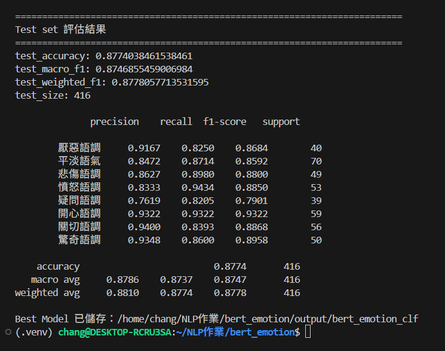
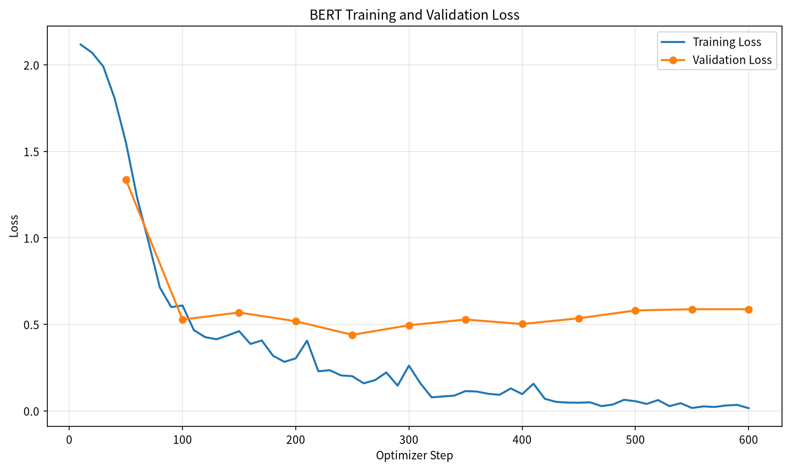
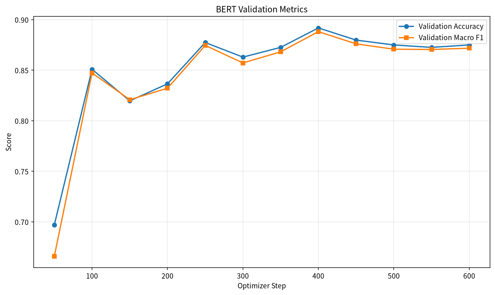
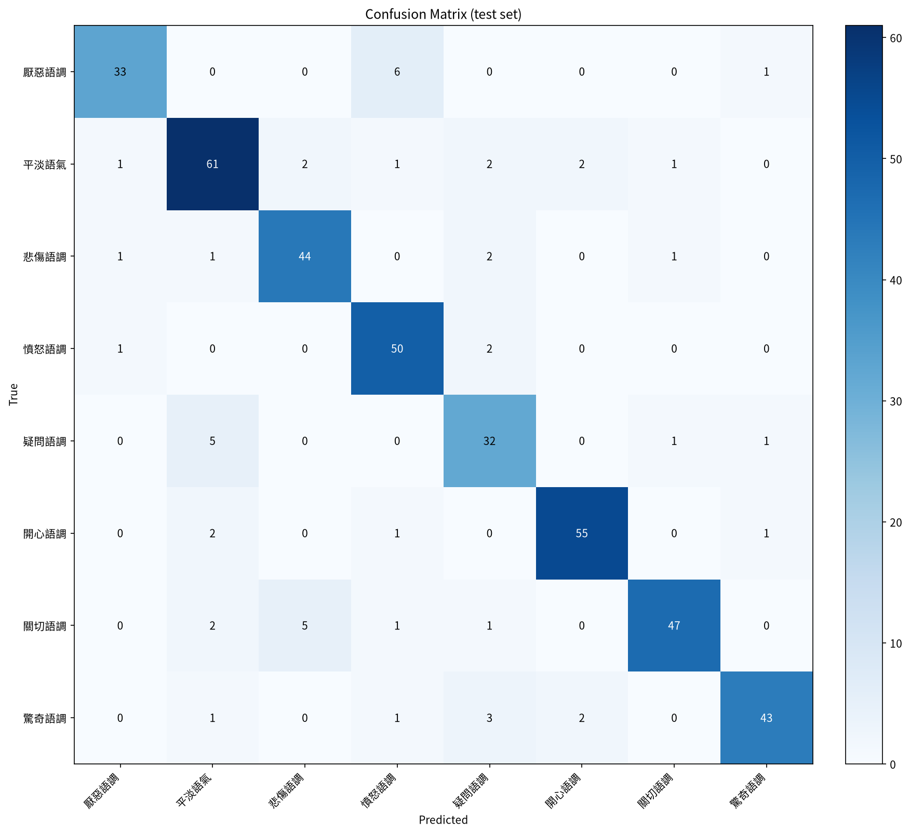
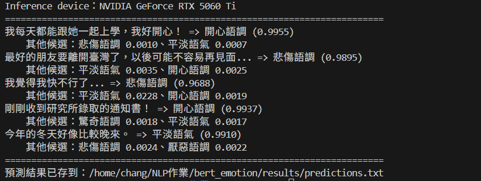

# 中文句子情緒分類（BERT 多元分類微調）

## 訓練資料來源
- [Datasets: Johnson8187/Chinese_Multi-Emotion_Dialogue_Dataset](https://huggingface.co/datasets/Johnson8187/Chinese_Multi-Emotion_Dialogue_Dataset)
- 共 4,159 筆中文對話句子，欄位為 `text`（句子）與 `emotion`（情緒語調）；移除 5 筆重複句子後，實際使用 4,154 筆

## 基礎模型
- [google-bert/bert-base-chinese](https://huggingface.co/google-bert/bert-base-chinese)

## 安裝套件
- torch (2.14.1+cu130)
- torchvision (0.29.1)
- torchaudio (2.11.0)
- transformers (5.17.0)
- datasets (5.0.1)
- evaluate (0.4.6)
- accelerate (1.15.0)
- scikit-learn (1.9.1)
- pandas (3.1.0)
- matplotlib (3.11.2)

執行環境：Python 3.14.4、NVIDIA GeForce RTX 5060 Ti（16 GB）、WSL2，BF16 混合精度訓練。

安裝方式：

```bash
# 1. 依照自己的 CUDA 版本安裝 PyTorch（https://pytorch.org/get-started/locally/）
#    本作業使用 PyPI 預設的 CUDA 13.0 版本
pip install torch torchvision torchaudio

# 2. 安裝其他套件
pip install -r requirements.txt
```

## 說明

這個模型把一句中文對話分類成不同的**情緒語調**，例如開心、悲傷、憤怒、驚奇、厭惡、疑問、平淡…等，類別數量與名稱由資料集自動決定（見 `data/bert/label_map.json`）。

課堂範例是二元分類（正面／負面），這份作業改成多元分類，主要修改如下：

| 項目 | 課堂範例（二元） | 本作業（多元） |
|---|---|---|
| label | `0 / 1` 已是整數 | 文字 label（如 `開心語調`）→ 由 `prepare_data.py` 轉成 `0, 1, 2, ...` |
| `num_labels` | 寫死 `2` | 從 `label_map.json` 讀取 |
| `id2label` / `label2id` | 寫死 | 從資料自動建立，並存進模型 `config.json`，推論時直接輸出中文類別 |
| 評估指標 | binary F1 | accuracy、macro F1、weighted F1 |
| 類別不平衡 | — | 使用 class weight 的 Cross-Entropy Loss |
| Best Model 依據 | `eval_loss` | validation `macro_f1` |
| 資料切分 | train / valid | train / valid / **test**（80/10/10，stratified） |

### Label 對照表
| id | 情緒 | train | valid | test |
|---|---|---:|---:|---:|
| 0 | 厭惡語調 | 324 | 40 | 40 |
| 1 | 平淡語氣 | 564 | 70 | 70 |
| 2 | 悲傷語調 | 388 | 49 | 49 |
| 3 | 憤怒語調 | 421 | 53 | 53 |
| 4 | 疑問語調 | 308 | 39 | 39 |
| 5 | 開心語調 | 473 | 59 | 59 |
| 6 | 關切語調 | 447 | 56 | 56 |
| 7 | 驚奇語調 | 397 | 50 | 50 |
| | **合計** | **3,322** | **416** | **416** |

### 指定句子的預測結果
```
我每天都能跟她一起上學，我好開心！ => 開心語調 (0.9955)
最好的朋友要離開臺灣了，以後可能不容易再見面... => 悲傷語調 (0.9895)
我覺得我快不行了... => 悲傷語調 (0.9688)
剛剛收到研究所錄取的通知書！ => 開心語調 (0.9937)
今年的冬天好像比較晚來。 => 平淡語氣 (0.9910)
```

### Test set 評估結果
| 指標 | 數值 |
|---|---|
| Accuracy | 0.8774 |
| Macro F1 | 0.8747 |
| Weighted F1 | 0.8778 |

Best Model 為 validation macro F1 最高的 epoch 3.85（valid macro F1 0.8882）；之後連續 4 次 evaluation 沒有進步，在 epoch 5.77 觸發 early stopping。整體訓練時間約 82 秒。

各類別 F1 中，**開心語調**最高（0.9322），**疑問語調**最低（0.7901）。從混淆矩陣看，最常見的錯誤是：
- 厭惡語調 → 憤怒語調（6 / 40 句），兩者都屬負面且語氣強烈
- 疑問語調 → 平淡語氣（5 / 39 句），沒有問號的疑問句容易被當成一般陳述
- 關切語調 → 悲傷語調（5 / 56 句），關心別人時常伴隨難過的情境

各類別的 precision / recall / F1 請見 [`results/classification_report.txt`](results/classification_report.txt)。

## 專案結構

```
.
├── prepare_data.py        # 下載資料、清理、文字 label → 整數、切 train/valid/test
├── train_bert.py          # 微調 BERT 多元分類，儲存 Best Model 並在 test set 評估
├── infer_bert.py          # 預測作業指定句子，輸出「句子 => 類別 (score)」
├── plot_metrics.py        # 畫 loss 曲線、validation 指標曲線、混淆矩陣
├── show_versions.py       # 列出套件版本，貼到 README 用
├── requirements.txt
├── fonts/                 # 繪圖用的中文字型（Noto Sans TC）
├── data/raw/data.csv      # 原始資料集（從 Hugging Face 下載）
├── data/bert/             # prepare_data.py 產生的資料與 label_map.json
├── output/bert_emotion_clf/   # 微調後的 Best Model（不含 checkpoint-*）
├── results/               # 測試集評估與預測結果
└── images/                # 訓練曲線與混淆矩陣
```

## 執行方法

```bash
python prepare_data.py     # 產生 data/bert/train.jsonl、valid.jsonl、test.jsonl、label_map.json
python train_bert.py       # 微調，Best Model 存到 output/bert_emotion_clf/
python plot_metrics.py     # 輸出 images/*.png
python infer_bert.py       # 預測作業指定的 5 句話

# 也可以預測自己的句子
python infer_bert.py "今天考試考砸了" "哇！你怎麼會在這裡？"
```

`prepare_data.py` 會先找 `data/raw/data.csv`，找不到才從 Hugging Face 下載。若下載失敗，可到資料集頁面的 **Files and versions** 手動下載 `data.csv`，放到 `data/raw/`。

### 主要超參數（`train_bert.py` 上方可修改）

| 參數 | 值 |
|---|---|
| MAX_SEQ_LENGTH | 128 |
| NUM_TRAIN_EPOCHS | 6（搭配 early stopping） |
| BATCH SIZE | 32 |
| LEARNING_RATE | 3e-5 |
| WARMUP_RATIO | 0.1 |
| EARLY_STOPPING_PATIENCE | 4 次 evaluation |
| 精度 | 支援 BF16 的 GPU 用 BF16，否則 FP16 |

GPU 記憶體不足時，把 `PER_DEVICE_TRAIN_BATCH_SIZE` 改成 16，並把 `GRADIENT_ACCUMULATION_STEPS` 改成 2。

## 成果

### 訓練過程


### Loss 曲線


### Validation 指標


### 混淆矩陣（test set）


### 推論結果


## 上傳模型到 GitHub（Git LFS）

`model.safetensors` 約 400 MB，超過 GitHub 單檔 100 MB 限制，需要 Git LFS（本專案的 `.gitattributes` 已設定好）：

```bash
git lfs install
git init
git add .
git commit -m "BERT multi-class emotion classifier"
git branch -M main
git remote add origin https://github.com/<你的帳號>/<repo 名稱>.git
git push -u origin main
```

`checkpoints/` 已列在 `.gitignore`，不會被上傳。

